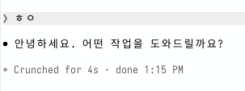

# claude-turn-duration

[](https://github.com/M1nu0x0/claude-turn-duration/releases)
[](https://github.com/M1nu0x0/claude-turn-duration/actions/workflows/ci.yml)
[](LICENSE)

[한국어](README.md) | [English](README.en.md) | **日本語**

Claude Desktop の回答の下にも、ターミナルと同じ `✻ Churned for 5s · done 14:48` の行を表示する Claude Code の mod です。

Claude Code のターミナルは回答が終わるたびに、かかった時間と終了時刻を 1 行で表示しますが、Claude Desktop にはこの行が表示されません。そこで Claude Code の mod（hooks モジュール）として、同じ行を自前で描画するように実装しました。

**[Website](https://m1nu0x0.github.io/claude-turn-duration/ja/) · [Releases](https://github.com/M1nu0x0/claude-turn-duration/releases) · [Changelog](CHANGELOG.md)**

| Claude Desktop（この mod） | ターミナル（Claude Code 標準） |
| --- | --- |
|  |  |

## インストール

Claude Code のターミナルのプロンプトで:

```
/plugin install turn-duration --marketplace M1nu0x0/claude-turn-duration
```

`Add marketplace?` に `y` と答え、scope は user を選びます。シェルからは次のようにインストールします。

```sh
claude plugin install turn-duration --marketplace M1nu0x0/claude-turn-duration
```

Claude Desktop では、プロンプト横の `+` → Plugins → Add marketplace に `M1nu0x0/claude-turn-duration` を入力し、`turn-duration` を追加します。

## 動作

- メインエージェントのターンが終わると（`turn.complete`）、かかった時間と終了時刻から `✻ <単語> for <時間> · done <時刻>` の行を作っておきます。サブエージェントのターンと空の回答はスキップします。
- 回答ブロックを描画するとき（`ui.render`、`AssistantMessage`）、その回答の最後のブロックの下に薄いイタリック体で付けます。
- 時間は 1 分未満なら `36s`、それ以上なら `1m 4s` と表示します。
- 時刻は OS の 12/24 時間設定とロケールを読んで合わせます。OS は判別せず、以下の設定をすべて試して読めた値だけを使います。どれも読めない場合はランタイムの既定ロケールを使います。
  - macOS: `defaults read -g` の `AppleICUForce24HourTime`、`AppleICUForce12HourTime`、`AppleLocale`
  - Windows: `HKCU\Control Panel\International` の `sShortTime`（`HH:mm` なら 24 時間、`tt h:mm` なら 12 時間）と `LocaleName`
  - Linux: ロケールは `LC_ALL` > `LC_TIME` > `LANG`、12/24 時間は GNOME の `org.gnome.desktop.interface clock-format`
- 先頭の単語（`Churned`、`Crunched`、`Brewed` など）は、ターミナルが選んだ単語を mod が受け取れないため、独自のリストからランダムに選びます。

## ターミナルでは

ターミナルに表示される `✻ … for Ns` の行はこの mod ではなく、Claude Code がもともと描画している TurnDuration の行です。mod はターミナルでは行を追加しないようコードで止めているので、二重に表示されることはありません。

## 構成

```
.claude-plugin/
  marketplace.json   このリポジトリ自体をマーケットプレイスとして登録
plugins/turn-duration/
  .claude-plugin/
    plugin.json      プラグインマニフェスト
  hooks/
    hooks.json       hooks モジュールの一覧
    register.tsx     turn.complete / ui.render フック
    format.ts        単語・時間・時刻のフォーマット
  types/index.d.ts   $.state の型定義
  tests/             claude plugin test 用のテスト
site/                GitHub Pages サイト（Astro）: src/site.json 翻訳、src/pages/ ページ、public/ スクリーンショット
README.en.md, README.ja.md  README の翻訳
```

プラグインは `plugins/turn-duration/` に分けて置き、マーケットプレイスから相対パスで参照します。claude.ai の Add marketplace は、リポジトリのルート自体がプラグインになっている構成を受け付けない場合があるためです。

## 開発

```sh
claude plugin validate .                     # マーケットプレイス
claude plugin validate plugins/turn-duration  # プラグイン
claude plugin test plugins/turn-duration
cd site && npm ci && npm run build           # サイトのビルドと検査（site/dist）
cd site && npm run dev                        # ローカルでプレビュー
cd site && npm run og                         # 言語ごとのリンクプレビュー画像を生成（Playwright が必要）
```

サイトは [Astro](https://astro.build) と共通キット [claude-plugin-site](https://github.com/M1nu0x0/claude-plugin-site) で作ります。文言はすべて `site/src/site.json` に、セクションの順序は `site/src/pages/[...lang].astro` にあります。`npm run build` は言語別のページ（`/`、`/ko/`、`/ja/`）と `sitemap.xml` を生成したあと、クローラーが読むとおりに検査し（タイトルと説明の長さ、canonical、hreflang、OG、JSON-LD、リンク切れと画像切れ、HTML の妥当性）、ひとつでも外れると失敗します。main にマージされると Pages ワークフローがビルドしてデプロイします。ページの JSON-LD にプラグインのバージョンが入るので、バージョンを上げるとサイトもデプロイし直されます。内容を変えたら `site/src/site.json` の `updated` もその日の日付にします。変えないと、プルリクエストで CI が警告します。`ask`、`answer`、`ogImageLine`、`ogImageText` を変えたら、`npm run og` で `site/public/images/og*.png` も生成し直してコミットします。

新しいバージョンは、`plugins/turn-duration/.claude-plugin/plugin.json` の `version` を上げる PR をマージしてから、同じバージョンで `vX.Y.Z` の Release を作成します。タグが作成されると、CI がタグと `version` が一致するかを確認します。

## License

MIT
