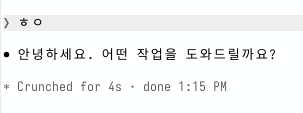

# claude-turn-duration

[](https://github.com/M1nu0x0/claude-turn-duration/releases)
[](https://github.com/M1nu0x0/claude-turn-duration/actions/workflows/ci.yml)
[](LICENSE)

**한국어** | [English](README.en.md) | [日本語](README.ja.md)

Claude Desktop 답변 아래에도 터미널처럼 `✻ Churned for 5s · done 14:48` 줄을 그려주는 Claude Code mod입니다.

Claude Code 터미널은 답변이 끝날 때마다 걸린 시간과 끝난 시각을 한 줄로 보여주지만, Claude Desktop에는 이 줄이 보이지 않습니다. 그래서 Claude Code의 mod(hooks 모듈)로 같은 줄을 직접 그리도록 구현했습니다.

**[Website](https://m1nu0x0.github.io/claude-turn-duration/ko/) · [Releases](https://github.com/M1nu0x0/claude-turn-duration/releases) · [Changelog](CHANGELOG.md)**

| Claude Desktop (이 mod) | 터미널 (Claude Code 기본) |
| --- | --- |
|  |  |

## 설치

Claude Code 터미널 프롬프트에서:

```
/plugin install turn-duration --marketplace M1nu0x0/claude-turn-duration
```

`Add marketplace?`에 `y`를 누르고 scope는 user를 고릅니다. 셸에서는 이렇게 설치합니다.

```sh
claude plugin install turn-duration --marketplace M1nu0x0/claude-turn-duration
```

Claude Desktop에서는 프롬프트 옆 `+` → Plugins → Add marketplace에 `M1nu0x0/claude-turn-duration`을 넣고 `turn-duration`을 추가합니다.

## 동작

- 메인 에이전트의 턴이 끝나면(`turn.complete`) 걸린 시간과 끝난 시각으로 `✻ <단어> for <시간> · done <시각>` 줄을 만들어 둡니다. 서브에이전트 턴과 빈 답변은 건너뜁니다.
- 답변 블록을 그릴 때(`ui.render`, `AssistantMessage`) 그 답변의 마지막 블록 아래에 흐린 기울임꼴로 붙입니다.
- 시간은 1분 미만이면 `36s`, 넘으면 `1m 4s`로 표시합니다.
- 시각은 OS의 12/24시간 설정과 로케일을 읽어 맞춥니다. OS를 따로 판별하지 않고 아래 설정을 모두 읽어 보며, 읽히는 값만 씁니다. 아무것도 읽지 못하면 런타임 기본 로케일을 씁니다.
  - macOS: `defaults read -g`의 `AppleICUForce24HourTime`, `AppleICUForce12HourTime`, `AppleLocale`
  - Windows: `HKCU\Control Panel\International`의 `sShortTime`(`HH:mm`이면 24시간, `tt h:mm`이면 12시간), `LocaleName`
  - Linux: 로케일은 `LC_ALL` > `LC_TIME` > `LANG`, 12/24시간은 GNOME의 `org.gnome.desktop.interface clock-format`
- 앞 단어(`Churned`, `Crunched`, `Brewed` 등)는 터미널이 고른 단어를 mod가 받을 수 없어서 자체 목록에서 무작위로 고릅니다.

## 터미널에서는

터미널에 보이는 `✻ … for Ns` 줄은 이 mod가 아니라 Claude Code가 원래 그리는 TurnDuration 줄입니다. mod는 터미널에서는 줄을 더하지 않도록 코드에서 막혀 있어서 두 번 보이지 않습니다.

## 구성

```
.claude-plugin/
  marketplace.json   이 레포를 마켓플레이스로 등록
plugins/turn-duration/
  .claude-plugin/
    plugin.json      플러그인 매니페스트
  hooks/
    hooks.json       hooks 모듈 목록
    register.tsx     turn.complete / ui.render 훅
    format.ts        단어, 시간, 시각 포맷
  types/index.d.ts   $.state 타입 계약
  tests/             claude plugin test 용 테스트
site/                GitHub Pages 사이트(Astro): src/site.json 번역, src/pages/ 페이지, public/ 스크린샷
README.en.md, README.ja.md  README 번역본
```

플러그인은 `plugins/turn-duration/`에 따로 두고 마켓플레이스가 상대경로로 가리킵니다. claude.ai의 Add marketplace는 레포 루트를 통째로 플러그인으로 쓰는 구성을 받아주지 않는 경우가 있어서입니다.

## 개발

```sh
claude plugin validate .                     # 마켓플레이스
claude plugin validate plugins/turn-duration  # 플러그인
claude plugin test plugins/turn-duration
cd site && npm ci && npm run build           # 사이트 빌드와 검사(site/dist)
cd site && npm run dev                        # 로컬 미리보기
cd site && npm run og                         # 언어별 링크 미리보기 이미지 생성(Playwright 필요)
```

사이트는 [Astro](https://astro.build)와 공용 키트 [claude-plugin-site](https://github.com/M1nu0x0/claude-plugin-site)로 만듭니다. 문구는 모두 `site/src/site.json`에, 섹션 순서는 `site/src/pages/[...lang].astro`에 있습니다. `npm run build`는 언어별 페이지(`/`, `/ko/`, `/ja/`)와 `sitemap.xml`을 만든 뒤 크롤러가 읽는 그대로 검사하고(제목·설명 길이, canonical, hreflang, OG, JSON-LD, 깨진 링크와 이미지, HTML 검증), 하나라도 어긋나면 실패합니다. main에 병합되면 Pages 워크플로가 빌드해 배포합니다. 페이지의 JSON-LD에 플러그인 버전이 들어가므로 버전을 올리면 사이트도 다시 배포됩니다. 내용이 바뀌면 `site/src/site.json`의 `updated`도 그날 날짜로 바꿉니다. 바꾸지 않으면 PR에서 CI가 경고합니다. `ask`, `answer`, `ogImageLine`, `ogImageText`를 바꾸면 `npm run og`로 `site/public/images/og*.png`도 다시 만들어 커밋합니다.

새 버전은 `plugins/turn-duration/.claude-plugin/plugin.json`의 `version`을 올리는 PR을 병합한 뒤, 같은 버전으로 `vX.Y.Z` Release를 만듭니다. 태그가 생기면 CI가 태그와 `version`이 같은지 확인합니다.

## License

MIT
