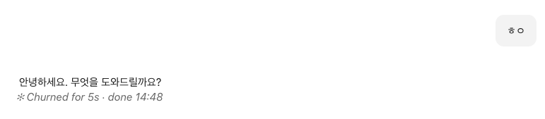
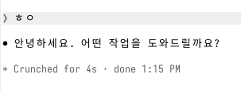

# claude-turn-duration

[](https://github.com/M1nu0x0/claude-turn-duration/releases)
[](https://github.com/M1nu0x0/claude-turn-duration/actions/workflows/ci.yml)
[](../LICENSE)

[한국어](../README.md) | **English** | [日本語](README.ja.md)

A Claude Code mod that draws the terminal's `✻ Churned for 5s · done 14:48` line beneath answers in Claude Desktop too.

The Claude Code terminal shows one line at the end of each answer with how long the turn took and when it finished, but Claude Desktop does not show this line. So I implemented it as a Claude Code mod (a hooks module) that draws the same line itself.

**[Website](https://m1nu0x0.github.io/claude-turn-duration/) · [Releases](https://github.com/M1nu0x0/claude-turn-duration/releases) · [Changelog](../CHANGELOG.md)**

| Claude Desktop (this mod) | Terminal (Claude Code built-in) |
| --- | --- |
|  |  |

## Install

At the Claude Code terminal prompt:

```
/plugin install turn-duration --marketplace M1nu0x0/claude-turn-duration
```

Answer `y` to `Add marketplace?` and choose the user scope. From a shell:

```sh
claude plugin install turn-duration --marketplace M1nu0x0/claude-turn-duration
```

In Claude Desktop, click `+` next to the prompt box → Plugins → Add marketplace, enter `M1nu0x0/claude-turn-duration`, then add `turn-duration`.

## How it works

- When a main-agent turn ends (`turn.complete`), it builds a `✻ <word> for <duration> · done <time>` line from the turn's duration and end time. Subagent turns and empty answers are skipped.
- When an answer block is drawn (`ui.render`, `AssistantMessage`), it attaches the line in dim italics beneath the last block of that answer.
- Durations under a minute read as `36s`; longer ones as `1m 4s`.
- The clock follows the OS's 12/24-hour setting and locale. It does not detect the OS; it tries all of the settings below and uses whichever can be read. If none can, the runtime's default locale is used.
  - macOS: `AppleICUForce24HourTime`, `AppleICUForce12HourTime` and `AppleLocale` from `defaults read -g`
  - Windows: `sShortTime` (`HH:mm` is 24-hour, `tt h:mm` is 12-hour) and `LocaleName` under `HKCU\Control Panel\International`
  - Linux: the locale from `LC_ALL` > `LC_TIME` > `LANG`, and 12/24-hour from GNOME's `org.gnome.desktop.interface clock-format`
- The leading word (`Churned`, `Crunched`, `Brewed`, ...) is picked at random from the mod's own list, because the word the terminal picks is not passed to mods.

## In the terminal

The `✻ … for Ns` line you see in the terminal is not from this mod; it is the TurnDuration line Claude Code draws on its own. The mod is blocked in code from adding a line in the terminal, so it never shows twice.

## Layout

```
.claude-plugin/
  marketplace.json   registers this repository as a marketplace
plugins/turn-duration/
  .claude-plugin/
    plugin.json      plugin manifest
  hooks/
    hooks.json       list of hooks modules
    register.tsx     turn.complete / ui.render hooks
    format.ts        word, duration and clock formatting
  types/index.d.ts   $.state type contract
  tests/             tests for claude plugin test
docs/                README translations (en, ja), screenshots,
                     GitHub Pages site
```

The plugin lives in its own folder, `plugins/turn-duration/`, and the marketplace points at it with a relative path, because claude.ai's Add marketplace can reject a repository whose root is itself the plugin.

## Development

```sh
claude plugin validate .                     # marketplace
claude plugin validate plugins/turn-duration  # plugin
claude plugin test plugins/turn-duration
```

For a new version, merge a PR that bumps `version` in `plugins/turn-duration/.claude-plugin/plugin.json`, then create a `vX.Y.Z` Release with the same version. When the tag is created, CI checks that the tag and `version` match.

## License

MIT
